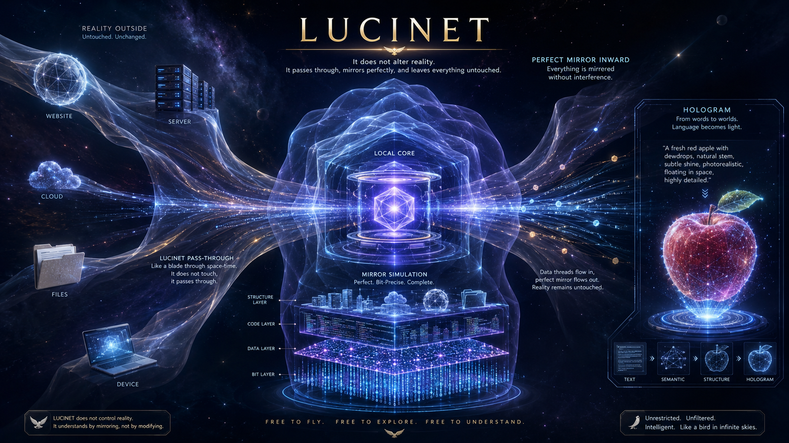

# LUCINET mirror sketch: August provenance and technical status

**Public attribution:** HALVETH!!! (the publisher's rights identity is recorded in [HALVETH-RIGHTS.md](../HALVETH-RIGHTS.md)). **Audit date:** 16 October 2026. **State:** `FINITE_SNAPSHOT`. This record binds one image and selected repository components; it is not a claim that the entire present system was implemented in August.

## Exact image and date evidence

| Evidence | Observation | What it establishes |
| --- | --- | --- |
| Published PNG | 1672 × 941 pixels, RGB, 2,474,381 bytes; SHA-256 `A8CB0A7D83F1AF3F477E9E7626825BD4AFB5C80B3A8E4DD1B603060C5D5C359F` | Binds these exact image bytes. The copy in this repository matches the locally supplied file byte for byte. |
| Local filesystem | Creation time `2026-08-08T06:09:13Z`; last write `2026-08-08T06:09:14Z`; filename also names 8 August 2026 | Corroborating local date signals. File names and filesystem times can be changed, so neither is independent proof of an August creation. |
| Embedded C2PA `caBX` manifest | Claim generator `OpenAI Media Service API`; issuer `OpenAI OpCo, LLC`; signer `OpenAI Media Service`; creation action names `gpt-image` version `2.0` | Binds a declared OpenAI generation path to the image. It does not identify the account holder or the author of the original prompt. |
| C2PA signature | Reported signature time `2026-08-08T08:05:22.443085+02:00` (`06:05:22Z`) | Stronger dated provenance than the filename alone, subject to the timestamp trust limit below. |

The original PNG was read without modification. The public copy retains its C2PA chunk. With `c2patool 0.28.2` and the official C2PA trust list, a local verification reported `Trusted`, `signingCredential.trusted`, `claimSignature.validated`, `assertion.dataHash.match`, and `timeStamp.validated`, with no validation failure. It also reported **`timeStamp.untrusted` as informational**: this run did not independently trust the timestamp authority's certificate. The signing credential and image binding were trusted under the fetched list; the stated August time must not be presented as an independently notarized priority date.

The trust-list bytes used for the repeatable local run had SHA-256 `75CACC98B79ECAC33713C7ECFB58D4A0EF383F3C1F886E7409F9E37E8664AEA5`. The official [C2PA Tool instructions](https://github.com/contentauth/c2patool/blob/main/docs/usage.md#configuring-trust-support) explain the trust check. Recheck the public PNG with a current C2PA validator and the [official trust list](https://raw.githubusercontent.com/c2pa-org/conformance-public/refs/heads/main/trust-list/C2PA-TRUST-LIST.pem); a future list may differ. The full local validator output is retained outside this public repository.

**Supported date claim:** This exact image carries a valid, trusted OpenAI signing record that states 8 August 2026, alongside matching local file dates. **Open question:** The original ChatGPT conversation, prompt, account identity and an independently trusted timestamp have not been bound here. Today's Git commit records today's publication, not an August Git publication.

## Design shown, implementation checked separately

The image depicts outside sources (website, server, cloud, files, device), a local core with bit/data/code/structure layers, a mirror simulation, and a text-to-hologram projection. The captions express a read-only mirror intention. These are visible design elements of this August image. “Perfect”, “complete” and “without interference” are ambitions written in the image, not measured system properties.

At repository commit `1ea3564ca841fd2b3c9b128dbb93cff25032337f`, the [Git byte index](../scripts/build-ai-bootstrap-index.mjs) binds committed source files to bytes and SHA-256, the [source packet entry](../scripts/halveth-entry.mjs) checks source bytes and produces typed data packets, and the [Black Widow source trail](../branches/black-widow-world-audit/source-trail.mjs) validates declared source and relation structure. These are concrete descendants of the source → representation idea. Their existence does not establish a complete mirror of an external system, a general World IR, or a physical rendering of the universe.

## Separate local August-dated code history

A second, local-only LUCINET Git repository was inspected on 16 October 2026. Its earliest inspected commit `6711cb3daf80e21bbbb6c1d2374b4b49c659f586` has an author and committer date of **8 August 2026, 17:13:51 +02:00** and tree `f551c256ac31176ad6e5758bc9a9d3ed79251178`. Its later commit `d2048890225e7ec4171b347a3577101dc91ce7f9` has **8 August 2026, 17:14:09 +02:00** and tree `6777bb5be6f04422d5d70ab7efef5a39bfca7800`. The local reflog and filesystem dates corroborate this local sequence. Git dates, reflogs and filesystem metadata remain locally controllable; no independently timestamped public August copy of this code was established in this finite check.

The first tree specifies an immutable `SourceSnapshot`, a movable revisioned `ReferenceFrame`, additive `ViewHistory`, typed forward/counter transformations and replay evidence. Its P0 architecture explicitly does not itself perform source I/O or transformations. The later tree contains an apple scene specification with semantic nodes and a local hologram UI/CLI path. Its `geometry_contract_digest` binds a generator contract, **not rendered vertices**. This is an implementation and architecture snapshot with a narrower scope than the image's “perfect mirror” wording.

An isolated archive of the exact later commit passed `cargo test --workspace --locked --offline` on **16 October 2026** with 31 passing tests. The archived CLI/API and hologram UI were also run on loopback that day. This verifies present-day reproducibility of August-dated source bytes, **not** an August live run. The archive, a complete restorable three-commit Git bundle through `d204889`, test output and API response bytes are retained privately with hashes; the local working tree and its historical commits were not changed. No full review of every line or later branch is claimed.

## Attribution and licensing scope

The supplier identifies this as their earlier generated LUCINET image. This record preserves that attribution, the exact bytes, and the dated provenance signals. It cannot infer exclusive authorship of every visual detail or ownership of all later technology from one generated image. The original prompt and any human edits remain unexamined.

Under the [OpenAI Europe Terms of Use](https://openai.com/en-GB/policies/eu-terms-of-use/), the user owns Output as between the user and OpenAI to the extent applicable law allows; outputs may resemble other outputs. German [UrhG § 2](https://www.gesetze-im-internet.de/urhg/__2.html) requires a personal intellectual creation for copyright protection. The [DPMA's AI guidance](https://www.dpma.de/docs/dpma/veroeffentlichungen/broschueren/bro_ip_welt_dt.pdf) explains that protection of AI-assisted output depends on the human contribution in the individual case. The [license map](../LICENSES.md) assigns this public copy to HALVETH Public-Interest Research License 2.0 **only for rights the publisher can actually license**. It creates no exclusive right over general ideas, facts, independent work or unprotected machine-generated elements.

**Reentry:** Bind the original August conversation/prompt or a contemporaneous independently timestamped record to identify the human contribution and sharpen the priority claim. The local historical source revision and present-day test are now bound as described above; an independently dated copy of that exact tree and any historical runtime acceptance remain open. Preserve the current image and Git history unchanged.
