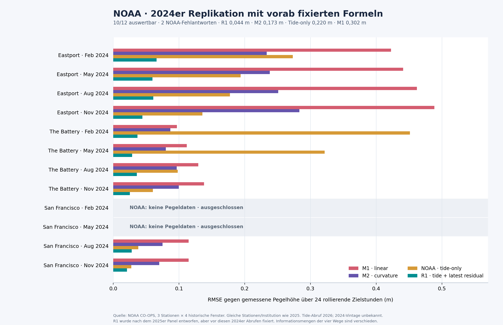

# LUCINET: spätere NOAA-Gegenprobe auf festgelegten 2024er Fenstern

**Stand:** 16. Oktober 2026 · **Reifegrad:** begrenzte historische Replikation · **Quellen:** [NOAA CO-OPS Data Retrieval API](https://api.tidesandcurrents.noaa.gov/api/prod/) und [Antwortschema](https://api.tidesandcurrents.noaa.gov/api/prod/responseHelp.html). Die vollständigen API-Antworten und Rechendateien liegen in einem lokalen, noch nicht versandten Prüfpaket.

## Warum eine zweite Probe?

Im [ersten NOAA-Panel](LUCINET_NOAA_ROLLING_BENCHMARK_2026-10-16.md) wurde die gezeiten- und messrestbasierte Formel `R1(i) = Tide(i) + Pegel(i−1) − Tide(i−1)` **erst nach Sichtung** der M1/M2- und Tide-only-Ergebnisse entworfen. Für diese zweite Probe wurden R1 und die anderen drei Formeln, die Stationen, zwölf andere historische Fenster, Abrufe, Ausschlüsse und Metriken **vor diesen neuen API-Abrufen** lokal fixiert. Der Plan hat SHA-256 `6C037526DFBB75DB07E9472967CA6E69282C08632B24A613518EFC531471C98C`. Das bindet die verwendete Plan-Datei; ein unabhängiger Zeitstempeldienst wurde nicht verwendet.

Die Stationen bleiben Eastport `8410140`, The Battery `8518750` und San Francisco `9414290`. Je Station waren 1.–2. Februar, Mai, August und November **2024** festgelegt. Das sind andere Zeitfenster, aber dieselben Stationen, NOAA-Produkte und teils dieselben physikalischen Zusammenhänge wie 2025. Dies ist eine weitere historische Datenprobe, keine unabhängige Sensorbestätigung.

## Auswertung vor dem Abruf festgelegt

- Genau zwei nur lesende GETs pro Fenster: `product=hourly_height` und `product=predictions&interval=h`; jeweils `datum=MLLW`, `time_zone=gmt`, `units=metric`, `format=json`, `application=LUCINET_benchmark`. Keine Wiederholung oder Ersetzung. Der Abruf-Receipt (24 Versuche) hat SHA-256 `AC3532F0B9BE9A21267B64D5E4BF1B207AA5BE47605055A28FCF9B58E136EA23`.
- Je Fenster sind 48 passende Stunden und bei Messwerten im Eingabebereich 0–31 NOAA-Flags `0,0` erforderlich. Das Flag belegt keine absolute Sensorfehlerfreiheit. Fehlantworten werden ausgeschlossen und sichtbar berichtet. Die Stunden 32–47 bleiben unbewertet.
- Der unveränderte öffentliche [Modellcode](../branches/lucinet-mirror-loop/model.mjs), SHA-256 `EC841C841E520009555142716D3C8B301857BEEF8AAEE0C710CAAD4D937FCC0D`, bestimmt M1 (letzte Verschiebung) und M2 (letzte Verschiebungsänderung). Die Pegelwerte 0–6 liefern eine Prognose für Ziel 7; dessen kleinerer quadratischer Fehler wählt M1 oder M2, bei Gleichstand M1. Danach werden 24 Ziele 8–31 **rollierend** eine Stunde voraus aus den bis dahin gemessenen Werten berechnet. Das ist kein 24-Stunden-Freilauf und keine Folge unabhängiger Fehler.
- T1 ist die NOAA-Tide-only-Reihe für die Zielstunde. R1 addiert zur Ziel-Tide den letzten gemessenen Unterschied zwischen Pegel und Tide. M1/M2 und R1 nutzen die vorige reale Pegelmessung; T1 nicht. R1 nutzt zusätzlich die NOAA-Harmonik. Der Zahlenvergleich ist daher **kein gleich informierter Modellwettbewerb**.

Die NOAA-GETs lieferten 24-mal HTTP 200. Für San Francisco Februar und Mai 2024 enthielten die **Pegel**-Antworten trotz HTTP 200 jeweils eine JSON-Fehlmeldung „No data was found …“ statt 48 Messwerten. Die beiden Fenster bleiben als `EXCLUDED` im festen Zwölferplan. Tide-Werte für sie wurden zwar abgerufen, aber nicht bewertet. Es wurden **10/12** Fenster und **240** rollierende Zielstunden ausgewertet. Die vollständige Auswertung hat SHA-256 `F4947A3E2F45B0DF64B8810C3EE571E93D0F33BEE097B58F73AE458BFAD7CA0D`; ein separat geschriebener Node-Prüfer rechnete die Rohwerte und alle Pool- und Fensterergebnisse nach (`PASS`).

## Ergebnis aller zwölf vorab benannten Fenster

| Station | Fenster 2024 | Status | Wahl an Ziel 7 | M1 RMSE m | M2 RMSE m | T1 RMSE m | R1 RMSE m |
| --- | --- | --- | --- | ---: | ---: | ---: | ---: |
| Eastport | Feb | auswertbar | M2, später besser | 0,4228 | 0,2336 | 0,2733 | **0,0660** |
| Eastport | Mai | auswertbar | **M1, später schlechter** | 0,4410 | 0,2381 | 0,1939 | **0,0599** |
| Eastport | Aug | auswertbar | M2, später besser | 0,4621 | 0,2510 | 0,1777 | **0,0610** |
| Eastport | Nov | auswertbar | **M1, später schlechter** | 0,4885 | 0,2832 | 0,1356 | **0,0443** |
| The Battery | Feb | auswertbar | M2, später besser | 0,0971 | 0,0868 | 0,4513 | **0,0369** |
| The Battery | Mai | auswertbar | M2, später besser | 0,1119 | 0,0799 | 0,3216 | **0,0290** |
| The Battery | Aug | auswertbar | **M1, später schlechter** | 0,1296 | 0,0967 | 0,0981 | **0,0361** |
| The Battery | Nov | auswertbar | M2, später besser | 0,1382 | 0,0998 | 0,0603 | **0,0252** |
| San Francisco | Feb | **ausgeschlossen**: NOAA-Pegelfehler | — | — | — | — | — |
| San Francisco | Mai | **ausgeschlossen**: NOAA-Pegelfehler | — | — | — | — | — |
| San Francisco | Aug | auswertbar | M2, später besser | 0,1148 | 0,0752 | 0,0382 | **0,0281** |
| San Francisco | Nov | auswertbar | M2, später besser | 0,1147 | 0,0702 | 0,0276 | **0,0210** |

Über die **240** gültigen Zielstunden gepoolt: **M1 0,302 m**, **M2 0,173 m**, **T1 0,220 m**, **R1 0,044 m** RMSE. Die punktuelle M1/M2-Wahl war in **7/10** auswertbaren Fenstern später die bessere und in **3/10** die schlechtere Wahl. R1 hatte in allen zehn gültigen Fenstern einen niedrigeren RMSE als jede der drei anderen Formeln. Die zwei ausgeschlossenen Fenster werden weder durch ein anderes Fenster ersetzt noch in den RMSE gemischt.

## Abrufbytes und Prüfgrenze

Die exakte URL entsteht aus dem NOAA-API-Pfad `https://api.tidesandcurrents.noaa.gov/api/prod/datagetter`, `begin_date=BEGIN`, `end_date=END`, `station=STATION` und den oben genannten Produkt-/Einheitsparametern. Die Rohantworten sind intern bytegenau gespeichert. In der folgenden Tabelle binden die Hashes die beiden tatsächlichen Antworten je vorab gewähltem Fenster, einschließlich der zwei JSON-Fehlantworten. `T1` ist die Tide-Antwort, `H` die Pegel-Antwort.

| Station | Beginn | H SHA-256 | T1 SHA-256 |
| --- | --- | --- | --- |
| `8410140` | `20240201` | `9D82F4AF8049A2CB034B9E5FBAEB7E6C5A1F6BA0447EA6C73784EA79C499057D` | `B8F7CCDA8364731A730ED0B09E3535886734560D355D1844096DA02477CC2029` |
| `8410140` | `20240501` | `B24F38F82FA7E588BB5EFFBD59918ED936770D60A7981C7998CA7A8A68AD142D` | `90DA65A25CE43E473B23CDD226A70AC5124C4F60EEC0D7366C63CA5741910FE2` |
| `8410140` | `20240801` | `054F79639135ED78FAB96F07563EA2DA6D82B10988A7634261A75E6B1B89819C` | `44DE33B9576D0EF72A2B4B758B6B29CF729236CD84FA5904E664C0E2A65ED90B` |
| `8410140` | `20241101` | `F8B108DD428BBFBAF656B8C90FEE16534180CA4591DCD51F3539D23F1FFDCD27` | `8B167C527D72D3FC90D3C1CEECCC76F1EE0E2E9BAD47F865615AF69981077FA3` |
| `8518750` | `20240201` | `3CC07F90C17647FB3B9E83DCDE71BCB039F4A74935B1D692543D2A8F5183A9C5` | `2DCE2BF64D4BB37E9953BDFD0B0F2729BAC992602EC27421F0C541BFF7AD4844` |
| `8518750` | `20240501` | `364B876EB17E1367667F9956E9C158B48E7FA6197AE01351246C490BFCA68C85` | `FD7ED29DE6A66DE614DBE9CEF215A0AF624592C9681C38E89136D4899DC4CDCC` |
| `8518750` | `20240801` | `274861BF19FBF013B06607BE49EED7AD18C07C09B3A8CCB7FFA9CF80B9DDC875` | `E6462C62A9EC4A690AAF180620F24C2343F3BF6145988D27F69609C770C87D94` |
| `8518750` | `20241101` | `3AD7415DB94F25675C54DE7EE0B687FD78ABB195AFCF5C9E3C1A1AA91840C3F4` | `0C09885489176ED275C4359C8B2BC569E3F3D4A2C386AF04CB01AB83D185B44A` |
| `9414290` | `20240201` | `500BDF8B7540E3B178FA94711E95E7BD7633578DAC4778DA5FAED9DC45CBFB0F` | `EDDD1370B3399F84E0EC2C4C7B51F2F929E9C3EDD3131EBED2F595E4C96D611E` |
| `9414290` | `20240501` | `500BDF8B7540E3B178FA94711E95E7BD7633578DAC4778DA5FAED9DC45CBFB0F` | `49A550B70BF872C1852416F5881C817FDB628EE5A6ABE56CE2AE88C6768EDC63` |
| `9414290` | `20240801` | `14DC51185024F0E1BB45814CC6248BAE099ACC06CEAC182DA8FA38806CC41B17` | `433872541EA13F8B85F588D46924649E0AF6D50E5508E1DFBA17BBDB90F36FF7` |
| `9414290` | `20241101` | `7EB08134C47CB6189D534FD0A885239EDED9A5F1D3A45339A06BE70C31D57007` | `CD5E333351529448034BE354D3436E19DF7CDD8DDC86C37344FBD9F61530071F` |

Die Prognosewerte für 2024 wurden **erst am 16. Oktober 2026** aus der NOAA-API geholt. Deren damalige Modell-/Harmonik-Vintage ist nicht gebunden. Das Ergebnis ist damit eine Replikation auf anderen historischen Zeitlagen der gleichen Quellenfamilie, **kein** Beweis einer 2024 as-of abgebbaren oder künftig erreichbaren Prognosegüte. Eine künftige prospektive Probe müsste den Tide-Datenstand vor den Zielstunden sichern und spätere reale Pegelwerte erst danach öffnen. Der aktuelle lokale Plan-/Receipt-/Auswertungs-Hash bindet Bytes und Ablaufdokumentation innerhalb dieses Projekts; er ist keine unabhängige Urheberschafts- oder Zeitbestätigung.
