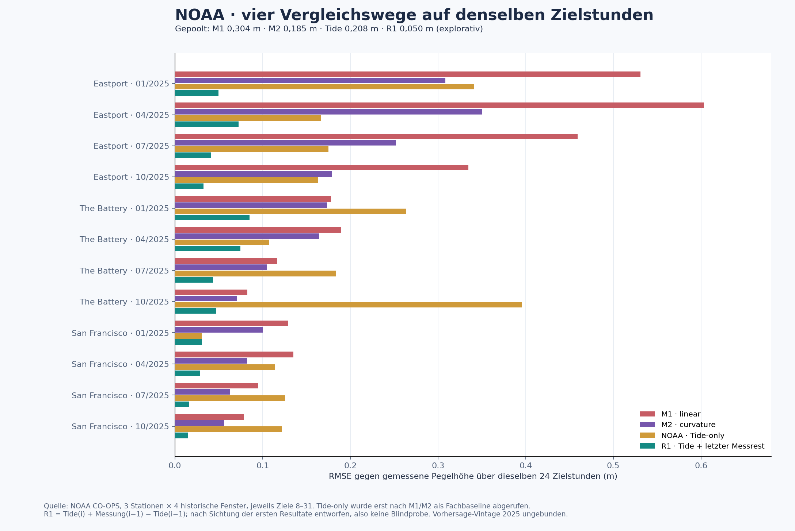

# LUCINET: rollierender Modellvergleich mit NOAA-Pegelmessungen

**Stand:** 16. Oktober 2026 · **Reifegrad:** begrenzter externer Messdaten-Benchmark · **Datenquelle:** [NOAA CO-OPS Data Retrieval API](https://api.tidesandcurrents.noaa.gov/api/prod/) und [Antwortschema](https://api.tidesandcurrents.noaa.gov/api/prod/responseHelp.html)


Der [synthetische LUCINET Mirror Loop](../branches/lucinet-mirror-loop/README.md) besitzt zwei feste, einfache Prognoseformeln. Hier laufen sie auf von NOAA als **verifiziert** bezeichneten stündlichen Pegelhöhen (`hourly_height`). Die Werte sind importierte Messdaten, keine von uns unabhängig geprüfte Sensorik. Dieser Bericht misst ausschließlich Ein-Stunden-Fehler der zwei Formeln in ausgewählten historischen Zeitfenstern.

## Fester Versuchsaufbau

- **Vorab gewählte Stichprobe:** Eastport (ME, `8410140`), The Battery (NY, `8518750`) und San Francisco (CA, `9414290`), jeweils 1.–2. Januar, April, Juli und Oktober 2025. Das sind zwölf nicht überlappende Zwei-Tage-Fenster. Die Stationen werden über vier Zeitfenster wiederverwendet und teilen NOAA als Datenquelle; die Resultate sind keine zwölf unabhängigen Provenienzbestätigungen. Diese zweite Stichprobe wurde **nach** der Sichtung einer einzelnen Eastport-Reihe vom September 2025 festgelegt.
- **Abruf:** Ein öffentlicher, nur lesender GET je Fenster; zwölf HTTP-200-Antworten. Jedes Fenster enthält genau 48 lückenlose Stunden mit NOAA-Flag `0,0`. Diese Flags sind ein Qualitätsmerkmal der API-Antwort, kein Nachweis absolut fehlerfreier Messung. Rohantworten und der volle lokale Auswertungsbeleg bleiben in der privaten Beweismappe; die exakten GET-Parameter und die SHA-256-Digests stehen unten.
- **Auswertungsindizes:** Von den 48 abgerufenen Werten sind nur **0–31** vorab für den Vergleich bestimmt; **32–47** bleiben unbenutzt. Die Modellformeln besitzen keine anhand der Pegelreihe geschätzten Parameter. Beide erhalten anfangs nur die tatsächlichen Werte **0–6** und prognostizieren Ziel **7**. Der kleinere Fehler an Ziel 7 wählt eine Formel für die weitere Bewertung; bei exaktem Gleichstand gewinnt `M1_LINEAR` nach ASCII-ID.
- **Rollierende Prüfung:** Es folgen genau **24** Zielstunden **8–31**. Vor jedem Ziel `i` sehen beide festen Formeln ausschließlich die inzwischen tatsächlich gemessenen Werte **0 bis i−1**. Der Wert `i` wird erst danach zum Fehlervergleich geöffnet und darf erst bei der folgenden Prognose als Eingabe dienen. Die Wahl aus Ziel 7 bleibt unverändert. Das ist ein *walk-forward* Ein-Stunden-Test mit 24 zeitlich korrelierten Fehlern je Fenster, **kein** frei laufender 24-Stunden-Forecast und **keine** von allen späteren Eingaben getrennte Holdout-Sequenz.
- **Oracle:** Unveränderter öffentlicher [Modellcode](../branches/lucinet-mirror-loop/model.mjs), Git-Stand `40ce4a3fdb422e163af58e409fd088003ac6aede`, Datei-SHA-256 `EC841C841E520009555142716D3C8B301857BEEF8AAEE0C710CAAD4D937FCC0D`. Der Datenadapter setzt `{x: Pegelhöhe in Meter über MLLW, y: 0}`. `M1_LINEAR` setzt die letzte Änderung fort; `M2_CURVATURE` setzt die letzte Änderungsänderung fort. Fehlermaß ist `(Prognose − Messwert)²` in m²; RMSE ist die Wurzel des Mittelwerts über 24 Ziele.

Die vollständige zweite Vorabbindung wurde vor dem ersten Panel-GET lokal fixiert; SHA-256 `5ECE17E833941BE5D5088B18577149EF4ED2425FA5F3B73C96BA5BC464E98A3A`. Der Abruf-Receipt hat SHA-256 `CA3879E59286C88EFF123DE50817EC10AD56E937A3521AC5B0155D3F9B82A830`, die vollständige Auswertung SHA-256 `13E275BF1E1F515184AE9CC5FA722D2E1CC2A7BAF315A73056D578DD16984E7E`. Ein separat formulierter Python-Prüfer rechnete alle zwölf Modellwahlen, 288 Ziel-Fehler und Poolwerte aus den gespeicherten Antworten erneut durch (`PASS`). Diese lokalen Digests belegen die heutigen Bytes, nicht den Aufnahmezeitpunkt jedes NOAA-Sensorwerts oder die Urheberschaft des August-Konzepts.

## Ergebnis aller vorab gewählten Fenster

| Station | Fenster 2025 | Wahl an Index 7 | M1 RMSE (m) | M2 RMSE (m) | Späterer Vergleich |
| --- | --- | --- | ---: | ---: | --- |
| Eastport | Jan | M2 | 0,5311 | 0,3085 | Wahl besser |
| Eastport | Apr | M2 | 0,6033 | 0,3506 | Wahl besser |
| Eastport | Jul | M2 | 0,4592 | 0,2524 | Wahl besser |
| Eastport | Okt | M2 | 0,3346 | 0,1790 | Wahl besser |
| The Battery | Jan | M2 | 0,1781 | 0,1732 | Wahl besser |
| The Battery | Apr | **M1** | 0,1896 | **0,1645** | **Wahl schlechter** |
| The Battery | Jul | M2 | 0,1168 | 0,1048 | Wahl besser |
| The Battery | Okt | M2 | 0,0828 | 0,0710 | Wahl besser |
| San Francisco | Jan | M2 | 0,1288 | 0,1003 | Wahl besser |
| San Francisco | Apr | **M1** | 0,1352 | **0,0824** | **Wahl schlechter** |
| San Francisco | Jul | M2 | 0,0948 | 0,0627 | Wahl besser |
| San Francisco | Okt | M2 | 0,0783 | 0,0561 | Wahl besser |

Alle zwölf Fenster waren auswertbar. An Index 7 wurde M2 zehnmal und M1 zweimal gewählt. Die festgehaltene Wahl hatte in **10/12** Fenstern den kleineren späteren MSE; in den beiden April-Fenstern von The Battery und San Francisco wählte sie die schlechtere Formel. Über sämtliche **288** rollierenden Ein-Stunden-Ziele gepoolt beträgt der RMSE **0,304 m** für M1 und **0,185 m** für M2. Diese Poolzahl gewichtet größere Ausschläge stärker und ersetzt die einzelnen Fenster nicht.

## Nachgelagerter Fachvergleich und Gegenbefund

Nach der M1-/M2-Auswertung wurden für exakt dieselben zwölf Fenster und Zielstunden NOAAs stündliche [astronomische Gezeitenvorhersagen](https://api.tidesandcurrents.noaa.gov/api/prod/) (`product=predictions`, `interval=h`) als Fachbaseline abgerufen. Eine zweite lokale Vorabbindung fixierte diese zwölf GETs vor dem Abruf; SHA-256 `63A243A587A82859A36B2DB05D871F4C6F338814F5428D396EEB05E1E0244F95`. Alle Antworten enthielten 48 passende GMT-Stunden im selben MLLW-Datum und in Metern. Der Fetch-Receipt hat SHA-256 `A50DA0B941FACA5BC5394D110AECC4F9E6348EBE1A3453603F602F7115506AF9`, die Auswertung `500324A86552EAD0E3124FD730826AB17BE7E588EBAD1E6FFF49B7396199D025`; eine separat geschriebene Nachrechnung bestätigte 288 Fehlerwerte und die Poolzahl.

Die historische NOAA-Tide alleine erreicht gepoolt **0,208 m** RMSE, in **7/12** Fenstern weniger als M1 und in **5/12** weniger als M2. Dieser Vergleich ist **nicht informationsgleich**: M1 und M2 nutzen vor jedem Ziel den zuletzt gemessenen Pegel, die Tide-only-Reihe in dieser Rechnung nicht. Außerdem wird die NOAA-Vorhersage **heute** für 2025 abgerufen. Die API-Antwort nennt keine festgehaltene 2025-Modellversion; ob die damals verwendeten Harmonikparameter identisch waren, ist offen. Die Messung und Tide-Vorhersage teilen NOAA und Station, sind also keine unabhängigen Quellen.

Deshalb wurde **nach Sichtung** der beiden vorherigen Resultate eine einfache Residualkorrektur als ausdrücklich *explorative* Vergleichsformel festgelegt: `R1(i) = Tide(i) + Messung(i−1) − Tide(i−1)`. R1 kennt den Zielmesswert `Messung(i)` nicht, nutzt aber die letzte wirkliche Messung **und** die Tidekurve. Der vor der Rechnung gespeicherte explorative Plan hat SHA-256 `D7362E7DCD64D38042A666E5BD14A95DCB00A1EAB409A913B1F0A47B721239F3`; die vollständige R1-Auswertung `9E9ADB68F8233EF347C361373A4E8C8045126B44BDD67B3D514DF19E01664342`. Eine zweite, unabhängig formulierte Rechnung bestätigte sie. R1 erreicht in denselben 288 Zielen gepoolt **0,050 m** RMSE und liegt in **12/12** Fenstern unter M1 und M2. Das ist ein starker Gegenbefund gegen die Vorstellung, M2 sei für Pegelwerte bereits ein gutes Fachmodell; wegen nachträglicher Konstruktion und zusätzlicher Tideinformation ist es **kein** blinder, gleich informierter Wettbewerb.



| Station | Fenster 2025 | Tide-only RMSE (m) | R1 RMSE (m) |
| --- | --- | ---: | ---: |
| Eastport | Jan | 0,3415 | 0,0497 |
| Eastport | Apr | 0,1666 | 0,0728 |
| Eastport | Jul | 0,1751 | 0,0408 |
| Eastport | Okt | 0,1633 | 0,0326 |
| The Battery | Jan | 0,2640 | 0,0852 |
| The Battery | Apr | 0,1075 | 0,0745 |
| The Battery | Jul | 0,1835 | 0,0435 |
| The Battery | Okt | 0,3960 | 0,0473 |
| San Francisco | Jan | 0,0304 | 0,0310 |
| San Francisco | Apr | 0,1144 | 0,0291 |
| San Francisco | Jul | 0,1255 | 0,0159 |
| San Francisco | Okt | 0,1218 | 0,0151 |

Für die nachgelagerte Tide-Abfrage gilt dieselbe Stations-/Datumsliste wie unten, aber mit `product=predictions&interval=h`:

```text
https://api.tidesandcurrents.noaa.gov/api/prod/datagetter?begin_date=BEGIN&end_date=END&station=STATION&product=predictions&datum=MLLW&time_zone=gmt&interval=h&units=metric&application=LUCINET_benchmark&format=json
```

## Exakte Quelle und Wiederöffnung

Für die ursprünglichen Messwerte lautete die einzige GET-Abfrage pro Fenster:

```text
https://api.tidesandcurrents.noaa.gov/api/prod/datagetter?begin_date=BEGIN&end_date=END&station=STATION&product=hourly_height&datum=MLLW&time_zone=gmt&units=metric&application=LUCINET_benchmark&format=json
```

`STATION` ist die Stations-ID oben; `BEGIN` und `END` sind der erste und zweite Tag des genannten Monats im Format `YYYYMMDD`. Die Antwortbytes der **Messwert-Abfragen** sind durch die folgenden SHA-256-Werte gebunden:

| Station | Beginn | Antwort-SHA-256 |
| --- | --- | --- |
| 8410140 | 20250101 | `7C8FEC145C61E567121EEB12A58B8CAA224B74CC53C1CEAC95CD583F0DA250C1` |
| 8410140 | 20250401 | `CC1E666AAAC4D5AA9BE10776C8875765B30354B230BB1C7CEF52AEC661A7A082` |
| 8410140 | 20250701 | `1D1BDE53BE8FA73DF2EAC7F81FDE2207DDF5C78C3559A0D1A124996304428495` |
| 8410140 | 20251001 | `9D83357521701CEB4E752BB08965CA1C7C2889F4DEC580463CAA9CA7A7DF9CF8` |
| 8518750 | 20250101 | `4A7EDDDF21D812F30581245C910E70E98EABFF1D8BB059E012DC5122F1C225C7` |
| 8518750 | 20250401 | `F0782A3DA13C365C55636250C794DAE5FF82FABD9F2C48C84FA50F46721D74EE` |
| 8518750 | 20250701 | `78288CE0EE0CB534DF52C54DD18E18FD583562BF4A15DE09E45E0E7490CE9E7B` |
| 8518750 | 20251001 | `E4342984D8CF3455CDF6CE2371E429B36D38465B782C43586536A3182978287D` |
| 9414290 | 20250101 | `3A8612087193BEABFC74B8A284CAE26EC9BC50E135B1C0A22CB62937F5C1FA6C` |
| 9414290 | 20250401 | `650C36C008B4568A3C167AAC2029825C5F5FB582C2C5354EF284DFE5972FBECC` |
| 9414290 | 20250701 | `0AD6AB27E1ECC2989AF167275635B4E2C91D2FA67B6F626674BFBBEB5BEE68B8` |
| 9414290 | 20251001 | `C908FBD0F4A43609FDEBB7E0D53BCB36A0B1C2D4C57721CCA21E2E746889A8D1` |

Die zwölf später abgerufenen **Tide-Vorhersage-Antworten** haben separat diese SHA-256-Werte:

| Station | Beginn | Tide-Antwort-SHA-256 |
| --- | --- | --- |
| 8410140 | 20250101 | `23783776D0DBF118EE7C71E5D23E0123CD7B57FE078AFD522BB54D23A966E365` |
| 8410140 | 20250401 | `EA58717BBE4CC80BD9D65C6E32C361729E16A51A628C0C4AB9EF9AEEFA2BDC3B` |
| 8410140 | 20250701 | `E1BB8B4A654D6CB33983A95E24AE1B20099C242D1D9907052BEB4AC967422801` |
| 8410140 | 20251001 | `8CCFB26F4ADEC9590B68BF354160461410D9ECEA7CA2A8A852A7616300E3331B` |
| 8518750 | 20250101 | `FD12825A4071DDFF4634B1F5DD8F80A4137D4A088B47961964A3174FC1446EFF` |
| 8518750 | 20250401 | `4E5DEE0965F3A5DDE80925063E0B9CB48DE01F6B8E03BAA723C7F37FC4F0E6E5` |
| 8518750 | 20250701 | `EDA55571EE58C71155E94BB66D47ADC87DD9DD1582B1FBF119D8CCE16A91D678` |
| 8518750 | 20251001 | `19B6CE493F59752577D2736CA1900CBA2E1355F0F6E2E97D962F0F466BE88D1F` |
| 9414290 | 20250101 | `B68A30BDC3B056C6792B61F66662750D94ADA525188198156269AD94A7625EAB` |
| 9414290 | 20250401 | `D94C44581BAD83B7CE2BC055193EC0908964E4F6C4A41B6300D0D20AD1776B93` |
| 9414290 | 20250701 | `7551BEF65D7C1AFCD0063FAEDEBFDCCD4DCF944AB0751711B9274B930B004F57` |
| 9414290 | 20251001 | `0CB1EE796D7A751B4FF7657355C0312D72247CD5805B17DC605DD4C5CFAA4A8D` |

**Praktische Grenze:** Die zwei ursprünglichen Formeln prüfen einen allgemeinen Vergleichsmechanismus, keinen konkurrenzfähigen Pegelalgorithmus. Die nachgelagerte R1-Rechnung macht sichtbar, dass eine sehr einfache Fachinformation plus letzte Messung in diesen Fenstern deutlich mehr erklärt. Die NOAA-Vintage von 2025, zufällig ausgewählte andere Stationen/Jahre, längere Forecast-Horizonte und eine unabhängige Sensorfehlerprüfung sind offen. Auch R1 ist bisher nur ein explorativer, historischer Rechenbefund; keine allgemeine Vorhersagegüte oder physikalischer „Reality Compiler“ ist belegt.

**Reopen-Trigger:** Ein neues, vor allen Quellenabrufen festgelegtes breiteres Stations-/Jahres-Sampling; ein zeitlich späterer Prognoselauf mit gebundener Vorhersage-Vintage, Sensorqualität und vollständig getrennten Auswertungsphasen. **Claim ceilings:** ursprünglicher M1/M2-Test `TWELVE_PRESELECTED_NOAA_WINDOWS_ROLLING_ONE_STEP_MODEL_COMPARISON_ONLY`; nachgelagerte Tide-Baseline `HISTORICAL_NOAA_PREDICTIONS_AS_DOMAIN_BASELINE_FOR_TWELVE_FIXED_WINDOWS_ONLY`; R1 `POSTHOC_EXPLORATORY_RESIDUAL_PERSISTENCE_ON_SAME_TWELVE_WINDOWS_ONLY`.
