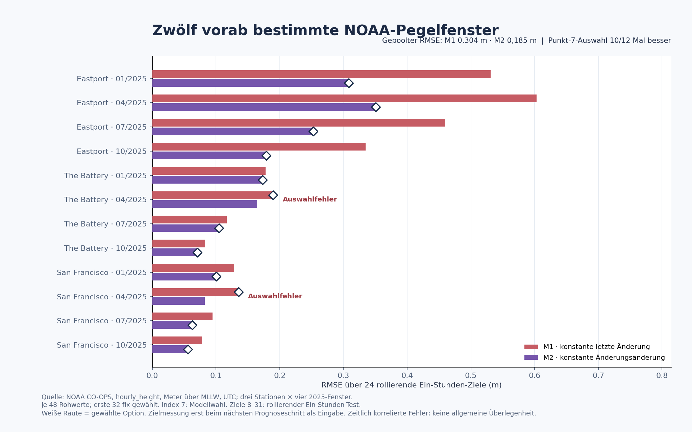

# LUCINET: rollierender Modellvergleich mit NOAA-Pegelmessungen

**Stand:** 16. Oktober 2026 · **Reifegrad:** begrenzter externer Messdaten-Benchmark · **Datenquelle:** [NOAA CO-OPS Data Retrieval API](https://api.tidesandcurrents.noaa.gov/api/prod/) und [Antwortschema](https://api.tidesandcurrents.noaa.gov/api/prod/responseHelp.html)



Der [synthetische LUCINET Mirror Loop](../branches/lucinet-mirror-loop/README.md) besitzt zwei feste, einfache Prognoseformeln. Hier laufen sie auf von NOAA als **verifiziert** bezeichneten stündlichen Pegelhöhen (`hourly_height`). Die Werte sind importierte Messdaten, keine von uns unabhängig geprüfte Sensorik. Dieser Bericht misst ausschließlich Ein-Stunden-Fehler der zwei Formeln in ausgewählten historischen Zeitfenstern.

## Fester Versuchsaufbau

- **Vorab gewählte Stichprobe:** Eastport (ME, `8410140`), The Battery (NY, `8518750`) und San Francisco (CA, `9414290`), jeweils 1.–2. Januar, April, Juli und Oktober 2025. Das sind zwölf nicht überlappende Zwei-Tage-Fenster. Die Stationen werden über vier Zeitfenster wiederverwendet und teilen NOAA als Datenquelle; die Resultate sind keine zwölf unabhängigen Provenienzbestätigungen. Diese zweite Stichprobe wurde **nach** der Sichtung einer einzelnen Eastport-Reihe vom September 2025 festgelegt.
- **Abruf:** Ein öffentlicher, nur lesender GET je Fenster; zwölf HTTP-200-Antworten. Jedes Fenster enthält genau 48 lückenlose Stunden mit NOAA-Flag `0,0`. Diese Flags sind ein Qualitätsmerkmal der API-Antwort, kein Nachweis absolut fehlerfreier Messung. Rohantworten und der volle lokale Auswertungsbeleg bleiben in der privaten Beweismappe; die exakten GET-Parameter und die SHA-256-Digests stehen unten.
- **Auswertungsindizes:** Von den 48 abgerufenen Werten sind nur **0–31** vorab für den Vergleich bestimmt; **32–47** bleiben unbenutzt. Die Modellformeln besitzen keine anhand der Pegelreihe geschätzten Parameter. Beide erhalten anfangs nur die tatsächlichen Werte **0–6** und prognostizieren Ziel **7**. Der kleinere Fehler an Ziel 7 wählt eine Formel für die weitere Bewertung; bei exaktem Gleichstand gewinnt `M1_LINEAR` nach ASCII-ID.
- **Rollierende Prüfung:** Es folgen genau **24** Zielstunden **8–31**. Vor jedem Ziel `i` sehen beide festen Formeln ausschließlich die inzwischen tatsächlich gemessenen Werte **0 bis i−1**. Der Wert `i` wird erst danach zum Fehlervergleich geöffnet und darf erst bei der folgenden Prognose als Eingabe dienen. Die Wahl aus Ziel 7 bleibt unverändert. Das ist ein *walk-forward* Ein-Stunden-Test mit 24 zeitlich korrelierten Fehlern je Fenster, **kein** frei laufender 24-Stunden-Forecast und **keine** von allen späteren Eingaben getrennte Holdout-Sequenz.
- **Oracle:** Unveränderter öffentlicher [Modellcode](../branches/lucinet-mirror-loop/model.mjs), Git-Stand `40ce4a3fdb422e163af58e409fd088003ac6aede`, Datei-SHA-256 `EC841C841E520009555142716D3C8B301857BEEF8AAEE0C710CAAD4D937FCC0D`. Der Datenadapter setzt `{x: Pegelhöhe in Meter über MLLW, y: 0}`. `M1_LINEAR` setzt die letzte Änderung fort; `M2_CURVATURE` setzt die letzte Änderungsänderung fort. Fehlermaß ist `(Prognose − Messwert)²` in m²; RMSE ist die Wurzel des Mittelwerts über 24 Ziele.

Die vollständige zweite Vorabbindung wurde vor dem ersten Panel-GET lokal fixiert; SHA-256 `5ECE17E833941BE5D5088B18577149EF4ED2425FA5F3B73C96BA5BC464E98A3A`. Der Abruf-Receipt hat SHA-256 `CA3879E59286C88EFF123DE50817EC10AD56E937A3521AC5B0155D3F9B82A830`, die vollständige Auswertung SHA-256 `13E275BF1E1F515184AE9CC5FA722D2E1CC2A7BAF315A73056D578DD16984E7E`. Ein separat formulierter Python-Prüfer rechnete alle zwölf Modellwahlen, 288 Ziel-Fehler und Poolwerte aus den gespeicherten Antworten erneut durch (`PASS`). Diese lokalen Digests belegen die heutigen Bytes, nicht den Aufnahmezeitpunkt jedes NOAA-Sensorwerts oder die Urheberschaft des August-Konzepts.

## Ergebnis aller vorab gewählten Fenster

| Station | Fenster 2025 | Wahl an Index 7 | M1 RMSE (m) | M2 RMSE (m) | Späterer Vergleich |
| --- | --- | --- | ---: | ---: | --- |
| Eastport | Jan | M2 | 0,5311 | 0,3085 | Wahl besser |
| Eastport | Apr | M2 | 0,6033 | 0,3506 | Wahl besser |
| Eastport | Jul | M2 | 0,4592 | 0,2524 | Wahl besser |
| Eastport | Okt | M2 | 0,3346 | 0,1790 | Wahl besser |
| The Battery | Jan | M2 | 0,1781 | 0,1732 | Wahl besser |
| The Battery | Apr | **M1** | 0,1896 | **0,1645** | **Wahl schlechter** |
| The Battery | Jul | M2 | 0,1168 | 0,1048 | Wahl besser |
| The Battery | Okt | M2 | 0,0828 | 0,0710 | Wahl besser |
| San Francisco | Jan | M2 | 0,1288 | 0,1003 | Wahl besser |
| San Francisco | Apr | **M1** | 0,1352 | **0,0824** | **Wahl schlechter** |
| San Francisco | Jul | M2 | 0,0948 | 0,0627 | Wahl besser |
| San Francisco | Okt | M2 | 0,0783 | 0,0561 | Wahl besser |

Alle zwölf Fenster waren auswertbar. An Index 7 wurde M2 zehnmal und M1 zweimal gewählt. Die festgehaltene Wahl hatte in **10/12** Fenstern den kleineren späteren MSE; in den beiden April-Fenstern von The Battery und San Francisco wählte sie die schlechtere Formel. Über sämtliche **288** rollierenden Ein-Stunden-Ziele gepoolt beträgt der RMSE **0,304 m** für M1 und **0,185 m** für M2. Diese Poolzahl gewichtet größere Ausschläge stärker und ersetzt die einzelnen Fenster nicht.

## Exakte Quelle und Wiederöffnung

Pro Tabellenzeile lautet die einzige gebundene GET-Abfrage:

```text
https://api.tidesandcurrents.noaa.gov/api/prod/datagetter?begin_date=BEGIN&end_date=END&station=STATION&product=hourly_height&datum=MLLW&time_zone=gmt&units=metric&application=LUCINET_benchmark&format=json
```

`STATION` ist die Stations-ID oben; `BEGIN` und `END` sind der erste und zweite Tag des genannten Monats im Format `YYYYMMDD`. Die Antwortbytes des damaligen Abrufs sind durch die folgenden SHA-256-Werte gebunden:

| Station | Beginn | Antwort-SHA-256 |
| --- | --- | --- |
| 8410140 | 20250101 | `7C8FEC145C61E567121EEB12A58B8CAA224B74CC53C1CEAC95CD583F0DA250C1` |
| 8410140 | 20250401 | `CC1E666AAAC4D5AA9BE10776C8875765B30354B230BB1C7CEF52AEC661A7A082` |
| 8410140 | 20250701 | `1D1BDE53BE8FA73DF2EAC7F81FDE2207DDF5C78C3559A0D1A124996304428495` |
| 8410140 | 20251001 | `9D83357521701CEB4E752BB08965CA1C7C2889F4DEC580463CAA9CA7A7DF9CF8` |
| 8518750 | 20250101 | `4A7EDDDF21D812F30581245C910E70E98EABFF1D8BB059E012DC5122F1C225C7` |
| 8518750 | 20250401 | `F0782A3DA13C365C55636250C794DAE5FF82FABD9F2C48C84FA50F46721D74EE` |
| 8518750 | 20250701 | `78288CE0EE0CB534DF52C54DD18E18FD583562BF4A15DE09E45E0E7490CE9E7B` |
| 8518750 | 20251001 | `E4342984D8CF3455CDF6CE2371E429B36D38465B782C43586536A3182978287D` |
| 9414290 | 20250101 | `3A8612087193BEABFC74B8A284CAE26EC9BC50E135B1C0A22CB62937F5C1FA6C` |
| 9414290 | 20250401 | `650C36C008B4568A3C167AAC2029825C5F5FB582C2C5354EF284DFE5972FBECC` |
| 9414290 | 20250701 | `0AD6AB27E1ECC2989AF167275635B4E2C91D2FA67B6F626674BFBBEB5BEE68B8` |
| 9414290 | 20251001 | `C908FBD0F4A43609FDEBB7E0D53BCB36A0B1C2D4C57721CCA21E2E746889A8D1` |

**Praktische Grenze:** Diese festen Formeln profitieren hier häufig von einer glatten periodischen Reihe; ein anspruchsvolles Gezeitenmodell, zufällige Auswahl anderer Stationen/Jahre, längere Forecast-Horizonte und robuste Sensorfehlerprüfung wurden nicht untersucht. Das Ergebnis belegt, dass der lokale Vergleichsmechanismus auf einer endlichen externen Messdatenstichprobe transparent ausgewertet werden kann. Es belegt weder allgemeine Vorhersagegüte noch einen physikalischen „Reality Compiler“.

**Reopen-Trigger:** Ein vorher festgelegtes, breiteres Stations-/Jahres-Sampling mit unabhängiger Sensor-/Qualitätsprüfung und einem passenden Gezeiten-Basismodell, danach ein echter zeitlich späterer Prognoselauf. **Claim ceiling:** `TWELVE_PRESELECTED_NOAA_WINDOWS_ROLLING_ONE_STEP_MODEL_COMPARISON_ONLY`.
